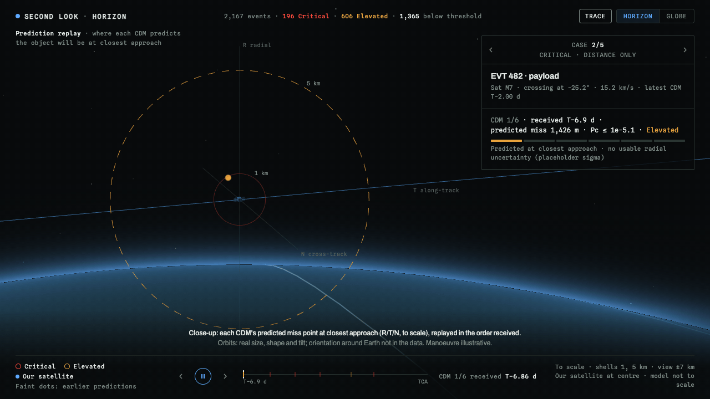
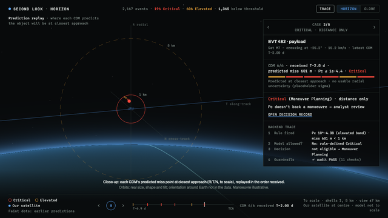
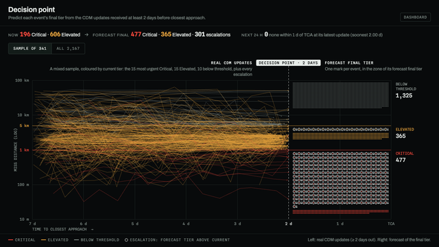
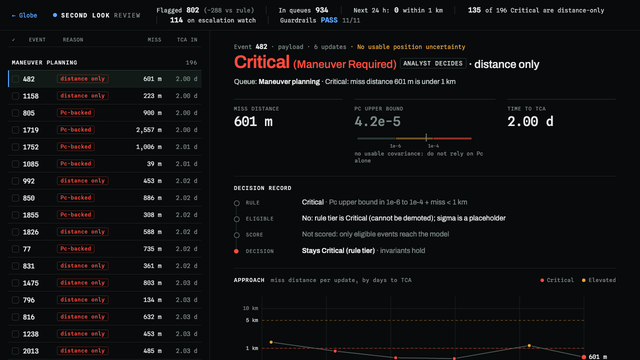
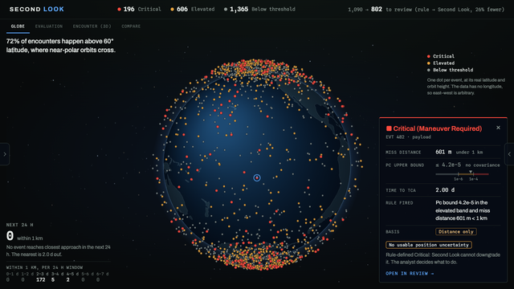

# Second Look: conjunction triage that preserves every rule-defined Critical

**Autonomous SG 2026 · Airbus Challenge #1 (satellite collision avoidance).** Second
Look cuts the review queue by a quarter, shows a decision record for every downgrade, and is
architecturally forbidden from downgrading a rule-defined Critical: published NASA/ESA rules tier every warning, and a
model may only remove over-warnings.

- **One in four flagged events is noise:** 1,090 → 802 events to review on the test set. Event level: all 288 removed events were truly below threshold at their latest update. Message level: 1 genuinely Elevated CDM was demoted (event 1278). Every rule-defined Critical is preserved (the rules set Critical; the model can't touch it), so Critical recall is 100% on test.
- **It shows where the rulebook wastes fuel:** 135 of 196 Critical events are Critical on miss distance alone, with a Pc upper bound below 1e-4. The analyst sees which manoeuvres the probability backs.
- **We set our safety gate before testing and stuck to it, even when it cost us a 23% better number.** On cross-validation a stricter v2 setting halves under-tiering at the same workload: our next step ([below](#our-eval-caught-our-bug)).

**CDMs arrive → rules tier every message → model removes only the over-warnings → analyst reviews a ranked queue with reasons → analyst decides**

> **Final predictions (official task) are in [`predictions/test_final_tier.csv`](predictions/test_final_tier.csv)**:
> one row per test event (2,167), with the predicted **final tier** at closest approach, made from messages 2+ days out.
> It also holds the rule floor, the decision (floor kept / escalated), the two model scores with their thresholds
> (uncalibrated ranking scores, not probabilities) and the reasons.
> The same predictions, with units, latitude and every message, are in [`predictions/test_final_tier_predictions.xlsx`](predictions/test_final_tier_predictions.xlsx).
> [`predictions/test_predictions.csv`](predictions/test_predictions.csv) is the per-message tier (one row per test CDM), not the final tier.

## Official task (organisers' update)

Predict each event's **final tier** (its last CDM before TCA) from its CDMs **>= 2 days out** only. Scored by 5-fold
event cross-validation over the 11,942 usable train events (`usable_for_training == yes`; no event split across folds),
270 of which escalate after the 2-day cut. `test_data` has no final outcomes, so it is not scored. From
[`data/demo/forecast_metrics.json`](data/demo/forecast_metrics.json) (mean over folds; counts summed):

| 5-fold event CV, 11,942 events | Critical recall | Critical precision | Critical F2 | Escalations caught | False escalations | Accuracy |
|---|---|---|---|---|---|---|
| Keep today's tier (miss-only) | 0.865 | **0.857** | 0.863 | 0/270 | **0** | **0.938** |
| Two miss-distance lines on the same floor (no model) | 0.897 | 0.755 | 0.864 | 73/270 | 766 | 0.888 |
| **Second Look forecast** | **0.911** | 0.757 | **0.875** | **79/270** | 775 | 0.888 |

- Second Look starts from today's tier, never lowers a rule-defined Critical (it preserves every rule-defined
  Critical), and escalates when the model's score crosses a threshold set for a **90% final-Critical recall target**
  (a target measured out of fold, not a guarantee).
- **Where we lose:** keeping today's tier is more accurate (0.938 vs 0.888) and more precise on Critical (0.857 vs
  0.757), and raises no false escalations. We buy higher Critical recall, better Critical F2 and 79 caught escalations
  with 775 false escalations over 11,942 events. It wins on Critical recall, Critical F2 and escalations caught, and
  loses on accuracy and Critical precision: it does not beat keeping today's tier across the board.
- **Two distance lines come close to the model:** "Critical if the latest miss <= ~1.1 km, Elevated if <= ~5.4 km"
  (both tuned train-only, the first to the same 90% target) gets Critical F2 0.864 vs 0.875 and 73 vs 79 escalations
  caught. The model is ahead in 5 of 5 folds, but by 0.002-0.022 F2; it loses on the 80/20 split (0.883 vs 0.896), and
  its thresholds move across folds where the lines do not. We do not claim the model beats a rule.
- **Expected queue on test:** the forecast marks 255 of the 2,167 test events Critical, against 196 by rule. Test
  events' latest message is mostly 2.0-2.4 days out (89% of events, median 2.19 d), so the 8,293-event cohort whose
  final message is never an input is the better guide to test than the CV above: there, Critical recall 0.883,
  precision 0.699, accuracy 0.876, so about 178 of the 255 would end Critical. Scores are class-weighted, not
  calibrated, and are never shown as probabilities. Method, the 80/20 split, baselines and limits:
  [docs/FORECAST.md](docs/FORECAST.md).

## See it



Each dot is one CDM's predicted miss point at closest approach, replayed in the order received; shells turn red as the prediction crosses 1 km. Orbits: real size, shape and tilt from the CDM; orientation around Earth isn't in the data. Manoeuvre illustrative.

| <br>**Horizon** · `/static/horizon.html`<br>Five cases replayed CDM by CDM in the close-up, each ending on its decision and backend trace; Globe shows our satellites' orbits. | <br>**Decision point** · `/static/decision.html`<br>Real miss-distance tracks up to 2 days before closest approach, then each event's forecast final tier. |
|---|---|
| <br>**Review page** · `/static/review.html`<br>Analyst queues and each event's decision record (rule, eligibility, score, decision) with its approach history. | <br>**Dashboard** · `/`<br>Every event on the globe by tier, with evaluation, 3D encounter and compare tabs. |

Run it locally: `uv sync && uv run uvicorn server:app`, then open http://127.0.0.1:8000/static/horizon.html. It serves the frozen `data/demo` reports and needs no API key ([Run it](#run-it)). MP4 version: [docs/media/horizon.mp4](docs/media/horizon.mp4).

## The problem

**User:** a conjunction assessment analyst on a satellite operator's flight dynamics team.
**Status quo:** every CDM whose Pc upper bound (`max_risk_estimate`) or miss distance crosses a
threshold gets a human look. **Cost, measured on our test set (24,484 CDMs):** that rule flags
**54.2%** of CDMs, and 4,534 of those are truly below threshold.

## What it does

- **Tiers** each CDM with the challenge's NASA (NASA/SP-20205011318) and ESA thresholds: Critical if Pc ≥ 1e-4 or miss < 1 km; Elevated if Pc ≥ 1e-6 or miss 1-5 km.
- **Demotes** only CDMs that are Elevated *solely* because of a loose Pc bound (miss > 5 km), and only to below threshold. It never touches Critical.
- **Flags** needs review, placeholder covariance (`no_covariance`) and probability dilution (`pc_diluted`). Flags only escalate.
- **Explains** each event: Claude rewords structured facts, with a template fallback.
- **Answers questions** through an operator copilot (`/chat`): every number comes from read-only triage tools, it can jump the dashboard to an event, and a rule-based fallback answers without an API key (`/health` says which path answered). Independent eval: 38/38 grounded, 38/38 avoid "safe", 38/38 no manoeuvre advice, in fallback mode ([docs/eval_results.md](docs/eval_results.md)); Claude mode not yet evaluated.
- **Handles bad input**: 26/26 junk and edge-case files are rejected clearly or flagged, never quietly tiered too low ([docs/robustness.md](docs/robustness.md)).
- **Proves it live:** `GET /api/audit` re-checks the safety invariants over every decision; `POST /api/triage` tiers any CDM you send, with its certificate.
  Each certificate says which rules fired, whether the model was allowed to act (and why not), its score against the stored threshold, and four invariants.
  On the frozen test set: PASS on 11/11 checks over 2,167 events and 24,484 CDM decisions; all 288 demotions have score < threshold.
  A tampered `events.json` (a Critical shown lower, a no-covariance event demoted) turns it FAIL and names the check ([docs/CONTRACT.md §6](docs/CONTRACT.md)).
- **Serves** an API and dashboard views (`/api/*`, `static/`), plus one prediction per test CDM in `predictions/test_predictions.csv` and the final-tier forecast per test event in `predictions/test_final_tier.csv`.

## How it works

| Job | Done by | LLM? |
|---|---|---|
| Assign the tier | Rules (`triage/tiers.py`) | No |
| Remove over-warnings | Gradient-boosted classifier with monotonic constraints, event-grouped CV (`triage/model.py`) | No |
| Detect unreliable inputs | Physics checks: placeholder sigma, sigma > miss/√2 (`triage/explain.py`) | No |
| Explain the event | Claude rewords fixed facts; template if no key, an error, or the word "safe" (`triage/explain.py`) | Yes |
| Decide on a manoeuvre | The analyst | No |

The demotion threshold is the 1% quantile of out-of-fold scores on truly-Elevated candidates.
`risk` (true log10 Pc) is the label only, never an input. Details: [docs/ALGO.md](docs/ALGO.md).

## How this differs

AI alert-prioritisation tools rank alerts. Second Look bounds what the model may do (demote only Pc-only Elevated,
never a rule-defined Critical, never with untrusted inputs) and records why for every downgrade.

## Results: per-message nowcast (supporting)

Held-out test set: 24,484 CDMs, 2,167 events. This is the tier of each CDM when it arrives (what the dashboard shows),
not the official final-tier task above. From [`data/demo/metrics.json`](data/demo/metrics.json). True classes: 15,756 below threshold, 6,501 Elevated, 2,227 Critical.

| Method | Critical recall | False alarms (truly below threshold) | Flagged | Under-tiered CDMs | Macro F1 |
|---|---|---|---|---|---|
| Majority class | 0% | 0 | 0.0% | 8,728 | 0.261 |
| Miss-distance rule | 95.9% | 0 | 31.4% | 1,116 | **0.952** |
| `max_risk_estimate` rule (status quo) | 100% | 4,534 | 54.2% | 0 | 0.841 |
| Pc bound OR miss < 1 km (untuned) | 100% | 4,534 | 47.3% | 1,693 | 0.779 |
| Miss rule + Pc bound for Critical only (untuned) | 100% | **8** | **31.5%** | 1,012 | 0.944 |
| **Ours** | **100%** | **2,214** | **44.7%** | **1** | 0.910 |

The two untuned rows are fixed rules from the brief, so scoring them on test is a baseline, not tuning. "False alarms"
counts truly-below-threshold CDMs flagged at any tier; the "false Elevated" figure below (4,526 / 2,206) leaves out 8
CDMs whose Pc bound is ≥ 1e-4 (shown Critical, never demoted) but whose true tier is below threshold.

**Where we lose:**
- The miss-distance rule has the highest macro F1 (0.952) but misses 4.1% of Critical CDMs (91 of 2,227), so we don't
  use it. Its F1 is flattering by construction: miss distance is half of the label, so it can never raise a false alarm.
- **The strongest simple baseline, miss rule + Pc bound for Critical only, beats us on false alarms (8 vs 2,214) and
  workload (31.5% vs 44.7%)** with the same 100% Critical recall, but shows 1,012 truly-Elevated CDMs as below
  threshold (we show 1). Our value is the Pc-Elevated band.

**Does the model beat a tuned rule?** Tuned rules are compared on train cross-validation only, never on test. With the
same 99% rule, a tuned Pc-bound threshold removes 9.7% of false alarms (with 47 under-tiered CDMs); our model removes
64.1% (with 39). Details: [docs/EVAL.md](docs/EVAL.md).

**Before → after (vs status quo):** false Elevated 4,526 → 2,206 (**-51%**, 2,320 fewer false
alarms); flagged 54.2% → 44.7%; events in the queue 1,090 → 802 (from `data/demo/events.json`);
Critical recall stays 100%. These are measured counts; analyst time saved is not measured.

## Where it fails (and how the analyst knows)

- **1 CDM tiered too low.** Event 1278 (test row 14473), 4.62 days to TCA, miss 23,375 m, Pc upper
  bound 10^-5.61; true Pc 10^-5.92 is just over 1e-6, so the truth is Elevated. We showed it as below
  threshold with confidence 0.99 and no flag. *Why:* it looks like its neighbours (6 of the event's
  10 bound-Elevated CDMs are truly below 1e-6). *How they'd know:* not from that CDM. The updates
  before (5.12 d) and after (4.39 d, needs review) stayed Elevated, and `baseline_tier` is kept next
  to `tier` on every update, so a demotion always shows as a demotion.
- **Over-tiered Criticals, by design.** 165 truly-Elevated CDMs (and 8 truly below threshold) are shown
  as Critical because their Pc bound is ≥ 1e-4. We never demote Critical.
- **63 events with placeholder sigma** (63,781,360 m). These are never demoted and always flagged `no_covariance`; the 61 below Critical are also needs review.
- **No test CDM within 2 days of TCA** (minimum 2.0002 d), so the 24 h panel is empty and the final window is untested.
- **The 99% is a recall target, measured on out-of-fold scores (not a formal guarantee),** and not per event. It holds only for events drawn like the training events.
- **Critical recall relies on the Pc bound holding.** True risk exceeds `max_risk_estimate` in 101 test CDMs, by at most 0.04 decade (0.14 on train); none crosses a tier line.

## Our eval caught our bug

Our first model regressed log Pc and flagged 100% of CDMs. Our evaluation caught this
before it shipped, so we redesigned it as targeted demotion.

**We set our safety gate before testing and stuck to it, even when it cost us a 23% better number.** We tried a
stronger v2 (more history and physics features, an ensemble scorer). On the test set it cut false alarms by a further
23%, but showed **3** truly-Elevated CDMs as below threshold, against our limit of 1, fixed before v2 was tested. An
independent verifier found no leakage; v1 ships.

That gate was weaker than it sounds. It was set on test, where under-tier counts are noisy: v1's cross-validated rate
predicts about 5.9 under-tiered CDMs on a test set this size, so seeing ≤ 1 had about a 2% chance. The stricter, honest
gate is the operator-invisible under-tier on cross-validation (not flagged, and no later update of the event shown at
its true tier): v1 has 23 such CDMs in 10 events, and v2 as tested has 20 (33 under-tiered). On cross-validation a
stricter v2 setting (0.995) halves under-tiering at the same workload (+1.1% false alarms): 17 under-tiered, 9
invisible. That is our next step; it is not shipped and has never been run on test ([docs/EVAL.md](docs/EVAL.md)).

## Trust and traceability

- Every tier lists the rules that fired (e.g. `Pc 10^-3.20 >= 1e-4 (critical threshold)`).
- Uncertainty only escalates: needs review and cautions never lower a tier.
- On an Elevated event, needs review marks a **close call** just above the model's demotion bar. These are mostly
  over-warnings (2.0% truly Elevated on cross-validation, against 32.1% for the other Elevated candidates the model
  keeps), not the riskiest rows, so an analyst can usually clear them. On placeholder-sigma or missing-input rows, needs
  review means the input can't be trusted (61 of the 84 needs-review test events also carry `no_covariance`).
- Claude only rewords structured facts and uses only their numbers. It is instructed never to recommend a manoeuvre, and each response records `claude` or `template` as its source.
- Tier 0 is "below threshold", never "safe". The analyst decides the manoeuvre.

## Assumptions

- **Final tier = the last CDM before TCA**, as in the organisers' labels (`challenge1_event_labels.xlsx`). Our
  recomputed final tier agrees with theirs on 13,154 of 13,154 train events.
- **Only CDMs >= 2 days before TCA are forecast inputs.** Later messages of an event are never seen by the forecast.
- **`risk` = -30 is treated as Pc ≈ 0** (below every threshold), not as missing.
- **Columns beyond the recommended list are display-only.** `latitude`, altitude and `mission_id` appear in the
  dashboard but are never model inputs. `risk` is the label only.
- **`test_data` has no final outcomes**, so the forecast is scored only by cross-validation on train events. The test
  set gets demo predictions (`predictions/test_final_tier.csv`), never a score.
- **The 3D horizon orbits are illustrative.** Where the view shows a real value it comes from the event (latitude,
  relative speed, miss distance, time-to-TCA order), but longitude and RAAN are not in the data, so where each orbit
  sits around the Earth is illustrative (`static/js/horizon-orbits.js`).
- **A recall target is a target, not a guarantee.** The forecast's 90% and the nowcast's 99% are measured out of fold
  on events drawn like the training events; they are not per event and may not carry over to a shifted live mix.

## What we don't solve yet

- A calibrated Pc estimate: we use the provided upper bound plus a classifier.
- Orbit propagation: the 3D view shows each object's relative position at TCA (distances to scale, no orbits); the globe shows conjunction latitude only, because the data has no longitude.
- A live CDM feed: `triage.predict --data any.csv` works on new files, but nothing streams.
- Configurable thresholds: they are fixed to the brief (`triage/tiers.py`).

## Run it

```bash
uv sync
uv run uvicorn server:app --reload    # http://127.0.0.1:8000, serves the frozen data/demo reports
```
Optional: put `ANTHROPIC_API_KEY` in `.env` (see `.env.example`) for Claude explanations; without it the template is used.

Full pipeline (organisers' CSVs in `data/raw/`, see [data/README.md](data/README.md)):
```bash
uv run python -m triage.train          # -> reports/model.joblib
uv run python -m triage.evaluate       # -> reports/metrics.json
uv run python -m triage.build_events   # -> reports/events.json
uv run python -m triage.predict        # -> predictions/test_predictions.csv (per message)
uv run python -m triage.forecast       # -> predictions/test_final_tier.csv (final tier per event; needs data/raw/labels/challenge1_event_labels.xlsx)
uv run python scripts/export_final_tier_xlsx.py  # -> predictions/test_final_tier_predictions.xlsx (same predictions)
uv run pytest -q                       # runs on data/sample, no key needed
```

Docs: [ALGO](docs/ALGO.md) (method) · [demo script](docs/demo-script.md) · [robustness](docs/robustness.md) · [copilot eval](docs/eval_results.md) · [CONTRACT](docs/CONTRACT.md) (interfaces) · [TEAM](docs/TEAM.md) (roles, workflow).

## Team

Tommy: model, API, PM · Franky: explanation, cautions, 3D close-approach and compare views ·
Reagan: dashboard · Kalent: independent evaluation
